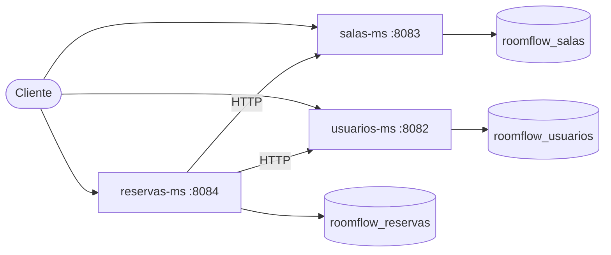

# Roomflow — Microsserviços

API de reserva de salas, migrada de um [monólito](https://github.com/pedrobuzolin/roomflow) para uma arquitetura de microsserviços com Java e Spring Boot. Cada serviço tem seu próprio repositório e seu próprio banco, e este repositório central reúne todos como submódulos e sobe o conjunto com um único comando.

## Arquitetura



| Serviço | Responsabilidade | Repositório | Porta | Banco (porta no host) |
|---|---|---|---|---|
| usuarios-ms | Cadastro e anonimização de usuários | [roomflow-usuarios-ms](https://github.com/pedrobuzolin/roomflow-usuarios-ms) | 8082 | `roomflow_usuarios` (5433) |
| salas-ms | Cadastro, ativação e desativação de salas | [roomflow-salas-ms](https://github.com/pedrobuzolin/roomflow-salas-ms) | 8083 | `roomflow_salas` (5434) |
| reservas-ms | Reservas, cancelamento e salas disponíveis | [roomflow-reservas-ms](https://github.com/pedrobuzolin/roomflow-reservas-ms) | 8084 | `roomflow_reservas` (5435) |

Portas reservadas para as próximas etapas: gateway 8080 e Eureka 8081.

## Tecnologias

Java 26 · Spring Boot 4.1 · Spring Data JPA · Flyway · PostgreSQL 17 · OpenFeign · Docker e Docker Compose · JUnit 5 e Mockito

## Como rodar

Requisitos: Docker e Docker Compose.

```bash
git clone --recurse-submodules https://github.com/pedrobuzolin/roomflow-microsservicos.git
cd roomflow-microsservicos
cp .env.example .env        # ajuste DB_USER e DB_PASSWORD, se quiser
docker compose up --build
```

Se clonou sem `--recurse-submodules`, rode `git submodule update --init`.

Ao subir, o Flyway cria as tabelas de cada banco automaticamente. Para encerrar: `docker compose down` (acrescente `-v` para apagar os dados).

## Exemplo de uso

```bash
# 1. criar um usuário e uma sala
curl -X POST localhost:8082/api/v1/usuarios -H "Content-Type: application/json" \
  -d '{"nome":"Maria","email":"maria@email.com"}'
curl -X POST localhost:8083/api/v1/salas -H "Content-Type: application/json" \
  -d '{"nome":"Sala Azul","capacidade":20}'

# 2. reservar (usa os ids retornados nos passos anteriores)
curl -X POST localhost:8084/api/v1/reservas -H "Content-Type: application/json" \
  -d '{"salaId":1,"usuarioId":1,"dataInicio":"2030-01-10T09:00:00","dataFim":"2030-01-10T10:00:00"}'

# 3. repetir o mesmo período devolve 409 (sala já reservada)

# 4. consultar salas disponíveis em um período
curl "localhost:8084/api/v1/reservas/salas-disponiveis?dataInicio=2030-01-10T09:00:00&dataFim=2030-01-10T10:00:00"
```

Erros seguem o padrão `ProblemDetail` (RFC 9457):

```json
{
  "type": "about:blank",
  "title": "Erro na aplicação",
  "status": 409,
  "detail": "A sala já está reservada neste período!",
  "tipoErro": "CONFLITO",
  "timestamp": "2030-01-10T08:55:00Z"
}
```

| Status | Quando |
|---|---|
| 400 | Dados inválidos, sala inativa, período invertido |
| 404 | Recurso inexistente (inclusive usuário inativo) |
| 409 | Conflito: sala já reservada no período, e-mail duplicado, cancelamento inválido |
| 503 | Um serviço necessário (usuarios-ms ou salas-ms) não respondeu |

## Decisões de arquitetura

| Ponto | Decisão | Motivo |
|---|---|---|
| Dados | Um banco por serviço, sem chave estrangeira entre bancos. A reserva guarda apenas `salaId` e `usuarioId`. | Cada serviço é dono dos seus dados e pode evoluir sozinho. Uma FK entre bancos acoplaria os serviços. |
| Conflito de horário | *Exclusion constraint* no PostgreSQL (`btree_gist`), com intervalo semiaberto `[início, fim)` considerando só reservas `ATIVA`. | No monólito, um lock pessimista no código garantia isso. A constraint garante sob concorrência no próprio banco, e reservas consecutivas (10h–10h) são permitidas. A violação vira 409 com mensagem clara. |
| Salas disponíveis | O reservas-ms pede ao salas-ms a lista de salas ativas e subtrai as que têm reserva ativa sobrepondo o período informado. | A disponibilidade depende do período e das reservas, dados que pertencem ao reservas-ms. Um campo `status` na sala não resolveria. |
| Criar reserva | Valida usuário e sala por HTTP síncrono. Usuário: 200 ativo, 404 inexistente ou inativo. Sala: 200 com o campo `ativa`, e o reservas-ms responde 400 se estiver inativa. | Reservas só precisam do estado atual. A sala inativa é uma regra da *operação de reservar*, então o 400 nasce no reservas-ms, não no salas-ms. |
| Desativar sala ou usuário | Pode ser feito com reserva em andamento (ela segue até o fim). Reservas futuras serão canceladas por evento (etapa de mensageria). Reativar não restaura reservas canceladas. | Não bloqueia a operação do dono do dado. A consistência entre serviços é eventual, via eventos. |
| Usuário removido | É anonimizado (e-mail e nome substituídos, inativo) em vez de apagado, e passa a responder 404. | Preserva o histórico das reservas e atende a motivação de proteção de dados (LGPD). |
| Versionamento | Rotas em `/api/v1` em todos os serviços. A evolução do projeto fica nas tags deste repositório. | O número na URL versiona o contrato da API, e não o projeto. |
| Erros | `GlobalExceptionHandler` por serviço, com `ProblemDetail` e três tipos de erro (validação, não encontrado, conflito). | Respostas de erro iguais em todos os serviços. |
| Comunicação entre serviços | URLs configuráveis por variável de ambiente (`USUARIOS_URL`, `SALAS_URL`) e timeouts de 2s para conexão e 3s para leitura. | Descoberta de serviços (Eureka) e gateway entram depois, sem mudar o código de negócio. |

## Limitações conhecidas

- Desativar uma sala ou um usuário ainda **não cancela** as reservas futuras dele. Isso depende da etapa de mensageria.
- Não há autenticação nem autorização ainda.
- Se usuarios-ms ou salas-ms estiver fora do ar, criar reserva responde 503. Não há retry nem *circuit breaker*.
- A lista de salas disponíveis é paginada em memória no reservas-ms, porque a lista de salas vem de outro serviço. Atende bem a volumes pequenos.
- A sobreposição de horários é validada na constraint do banco. Ainda não há teste automatizado contra um PostgreSQL real.

## Roadmap

- [x] **Etapa 1:** três microsserviços com banco próprio, REST, comunicação síncrona e Docker Compose
- [ ] **Etapa 2:** Spring Security com perfis ADMIN e USER
- [ ] **Etapa 3:** autenticação externa (login com GitHub ou Google, ou 2FA)
- [ ] **Etapa 4:** mensageria: evento `ReservaCriada` (RabbitMQ) e `ReservaRegistrada` (Kafka), com idempotência por `eventId`
- [ ] **Etapa 5:** testes de integração com Testcontainers
- [ ] **Etapa 6:** documentação OpenAPI/Swagger, testes de API e pipeline no GitHub Actions
- [ ] Extras: Eureka e API Gateway

## Testes

Cada serviço tem testes unitários (JUnit 5 e Mockito) e testes de controller (`@WebMvcTest`). Dentro da pasta do serviço:

```bash
./mvnw test
```

## Autor

Pedro Buzolin · [GitHub](https://github.com/pedrobuzolin)
